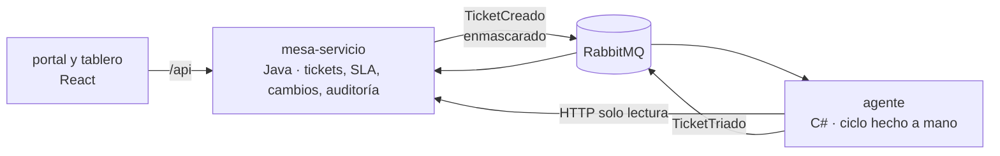

# Centinela

Mesa de servicio de TI para entidades financieras, con triaje asistido por IA. Proyecto de portafolio.

Cuando alguien reporta un ticket, un agente de IA programado desde cero lo analiza con herramientas de solo lectura: sugiere categoría, sistema afectado y prioridad, busca duplicados y artículos de la base de conocimiento, y redacta un borrador de respuesta. **El agente recomienda; el técnico decide.** Ninguna sugerencia se aplica sola.

> **En construcción.** Fase actual: 0 (preparación). Avance en [docs/ROADMAP.md](docs/ROADMAP.md).

## Cómo funciona



## Objetivos del proyecto

- Monolito modular para el núcleo y el agente como servicio aparte con RabbitMQ: separado solo donde hay una razón real ([ADR-003](docs/decisiones/ADR-003-cambio-dominio-tickets.md))
- Java + Spring Boot, C# .NET, React + TypeScript, PostgreSQL + pgvector ([ADR-002](docs/decisiones/ADR-002-lenguajes.md))
- Un agente de IA sin frameworks: el ciclo modelo → herramienta → resultado escrito a mano, con límites de iteraciones, tiempo y tokens
- Datos sensibles (cédulas, cuentas, tarjetas, correos, teléfonos) enmascarados antes de llegar al modelo
- Reglas de una entidad financiera: SLA con calendario laboral, segregación de funciones en los cambios y bitácora de auditoría de solo inserción
- Seguridad basada en OWASP (web, APIs, LLM y agentes), con una suite de ataques contra el agente ([docs/SEGURIDAD.md](docs/SEGURIDAD.md))
- SLA, calidad del triaje y costo de la IA medidos en Power BI ([docs/KPIS.md](docs/KPIS.md))
- Datos 100 % sintéticos

## Entorno de desarrollo

Requisitos: Docker con Compose, OpenSSL (viene con Git Bash) y, para guardar los secretos cifrados, [SOPS](https://github.com/getsops/sops) y [age](https://github.com/FiloSottile/age).

```bash
cp .env.example .env                 # solo configuración, sin contraseñas
./scripts/secretos.sh generar        # crea las contraseñas en secrets/ (fuera de git)
docker compose up -d                 # PostgreSQL (con pgvector) y RabbitMQ
docker compose ps                    # ambos deben quedar "healthy"
```

Los secretos llegan a cada contenedor como archivos en `/run/secrets/`, nunca como variables de entorno ([ADR-005](docs/decisiones/ADR-005-gestion-de-secretos.md)). Para llevarlos a otra máquina:

```bash
./scripts/secretos.sh llave          # crea tu llave de age y la registra en .sops.yaml
./scripts/secretos.sh cifrar         # secrets/ → secrets.enc.env (este sí se versiona)
./scripts/secretos.sh descifrar      # en la otra máquina, con su llave registrada
```

- PostgreSQL en `127.0.0.1:5432`, con roles y esquemas por servicio ([docs/ARQUITECTURA.md](docs/ARQUITECTURA.md#base-de-datos)).
- Panel de RabbitMQ en http://127.0.0.1:15672 (usuario `centinela`, contraseña en `secrets/rabbitmq_password`).

Los roles y esquemas se crean solo la primera vez, cuando el volumen está vacío. Para recrearlos: `docker compose down -v` (borra los datos).

### Secretos fuera del repo

Este repositorio es público y no contiene ninguna contraseña ni API key en texto plano:

- Las contraseñas de desarrollo viven en `secrets/` (ignorada por git). En el repo solo está `secrets.enc.env`, cifrado con age.
- La API key del modelo vive en `dotnet user-secrets`, fuera de la carpeta del proyecto.
- Un hook de pre-commit con [gitleaks](https://github.com/gitleaks/gitleaks) bloquea cualquier commit que traiga un secreto. Se activa una vez por clon:

  ```bash
  git config core.hooksPath .githooks
  ```

- En GitHub, el CI vuelve a buscar secretos en todo el historial en cada push.

El agente de IA tiene sus propias instrucciones de uso en [services/agente/README.md](services/agente/README.md).

## Documentación

| Documento | Contenido |
|---|---|
| [ARQUITECTURA](docs/ARQUITECTURA.md) | Servicios, módulos, base de datos y estructura del repositorio |
| [EVENTOS](docs/EVENTOS.md) | Contratos de los mensajes |
| [SEGURIDAD](docs/SEGURIDAD.md) | Riesgos, controles y suite adversaria |
| [KPIS](docs/KPIS.md) | Indicadores de servicio, calidad del triaje y costo |
| [CONTEXTO](docs/CONTEXTO.md) | De dónde salió el proyecto y por qué |
| [Decisiones](docs/decisiones/) | ADRs: arquitectura, lenguajes, dominio, login, secretos y proveedor del modelo |

## Licencia

[MIT](LICENSE).
