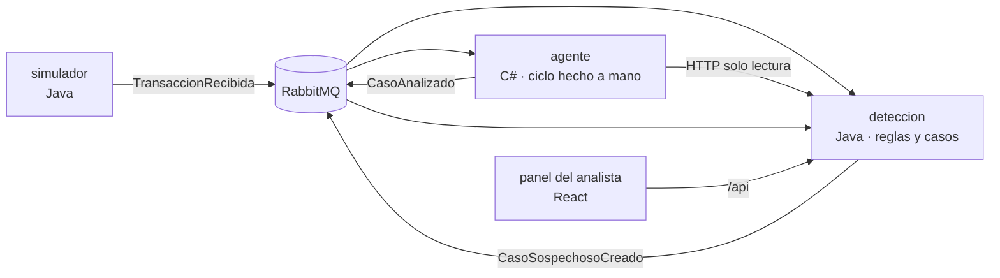

# Centinela

Sistema de análisis antifraude asistido por IA, construido como proyecto de portafolio.

Un motor de reglas filtra las transacciones; solo las sospechosas llegan a un agente de IA programado desde cero, que investiga con herramientas de solo lectura y deja una recomendación. **La decisión final siempre la toma un analista humano.**

> **En construcción.** Fase actual: 0 (preparación). Avance en [docs/ROADMAP.md](docs/ROADMAP.md).

## Cómo funciona



## Objetivos del proyecto

- Microservicios mínimos orientados a eventos con RabbitMQ: solo donde hay una razón real ([ADR-001](docs/decisiones/ADR-001-arquitectura.md))
- Java + Spring Boot, C# .NET, React + TypeScript, PostgreSQL ([ADR-002](docs/decisiones/ADR-002-lenguajes.md))
- Un agente de IA sin frameworks: el ciclo modelo → herramienta → resultado escrito a mano, con límites de iteraciones, tiempo y tokens
- Seguridad basada en OWASP (web, APIs, LLM y agentes), con una suite de ataques contra el agente ([docs/SEGURIDAD.md](docs/SEGURIDAD.md))
- Costo y valor del agente medidos en Power BI ([docs/KPIS.md](docs/KPIS.md))
- Datos 100 % sintéticos

## Entorno de desarrollo

Requisitos: Docker con Compose.

```bash
cp .env.example .env      # completar las contraseñas
docker compose up -d      # PostgreSQL y RabbitMQ
docker compose ps         # ambos deben quedar "healthy"
```

- PostgreSQL en `127.0.0.1:5432`, con un usuario y un esquema por servicio.
- Panel de RabbitMQ en http://127.0.0.1:15672.

Los usuarios y esquemas se crean solo la primera vez, cuando el volumen está vacío. Para recrearlos: `docker compose down -v`.

## Documentación

| Documento | Contenido |
|---|---|
| [ARQUITECTURA](docs/ARQUITECTURA.md) | Servicios, módulos y estructura del repositorio |
| [EVENTOS](docs/EVENTOS.md) | Contratos de los mensajes |
| [SEGURIDAD](docs/SEGURIDAD.md) | Riesgos del agente, controles y suite adversaria |
| [KPIS](docs/KPIS.md) | Indicadores de costo y valor |
| [CONTEXTO](docs/CONTEXTO.md) | De dónde salió el proyecto y por qué |
