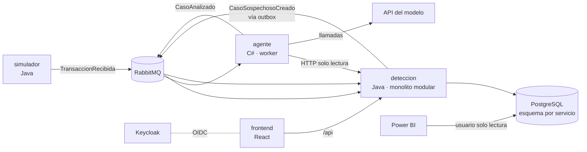

# Arquitectura

Decisión y alternativas en `docs/decisiones/ADR-001-arquitectura.md` (estado: Aceptado).

## Vista general



## Servicios

| Servicio | Responsabilidad | Escribe en | Lee de | Arquitectura interna |
|---|---|---|---|---|
| `simulador` | Genera transacciones sintéticas (normales y fraudulentas) a un ritmo configurable | Esquema `simulador` (semillas de clientes) | — | Capas clásicas |
| `deteccion` | Recibe transacciones, aplica reglas, crea casos, recibe el análisis del agente y la decisión del analista, expone vistas de reporte | Esquemas `deteccion` y `reportes` (vistas de KPIs y `reportes.parametros`) | Eventos | Monolito modular |
| `agente` | Investiga cada caso sospechoso con herramientas de solo lectura y publica un análisis con recomendación | Esquema `agente` (mensajes y casos procesados, métricas por caso, tokens del día) | API interna de `deteccion`, eventos | Hexagonal ligero |

Usuarios de PostgreSQL: uno por servicio (`simulador`, `deteccion`, `agente`), cada uno dueño de sus esquemas y sin acceso a los demás. `powerbi_ro` solo tiene `SELECT` sobre `reportes`. Los crea `deploy/postgres/init/01-esquemas-y-usuarios.sh` al levantar el contenedor por primera vez.
| `frontend` | Panel del analista: bandeja de casos, detalle con el análisis del agente, aprobar o rechazar | — | `/api` de `deteccion` | Bulletproof React |

## Módulos de `deteccion`

| Módulo | Qué hace |
|---|---|
| `ingesta` | Consume `TransaccionRecibida`, valida y guarda |
| `reglas` | Evalúa reglas deterministas (monto inusual, país distinto, velocidad de transacciones, comercio de riesgo) y calcula un puntaje |
| `casos` | Crea casos sobre el umbral, publica `CasoSospechosoCreado`, guarda `CasoAnalizado`, registra la decisión del analista. Expone la API interna de solo lectura para el agente, consultada por `casoId`: devuelve solo datos del cliente de ese caso |
| `reportes` | Vistas SQL de KPIs para Power BI |

## Interior del `agente` (hexagonal ligero)

```
services/agente/
├── src/Centinela.Agente/
│   ├── Dominio/          Caso, Hallazgo, Recomendacion, PresupuestoCaso (sin dependencias externas)
│   ├── Aplicacion/       CicloAgente (el loop), RegistroMetricas
│   ├── Puertos/          IClienteLlm, IHerramienta, IPublicadorEventos
│   └── Infraestructura/
│       ├── Llm/          ClienteAnthropicHttp (HttpClient a mano)
│       ├── Herramientas/ HistorialCliente, PerfilGasto, TransaccionesRecientes
│       └── Mensajeria/   Consumidor y publicador de RabbitMQ
└── tests/
    ├── Centinela.Agente.Tests/       unitarios del ciclo con un IClienteLlm falso
    └── Centinela.Agente.Adversarial/ suite de ataques
```

Justificación de las interfaces: `IClienteLlm` es una frontera real (API externa) y permite probar el ciclo sin gastar tokens; `IHerramienta` tiene varias implementaciones reales; `IPublicadorEventos` separa el dominio de RabbitMQ.

## Estructura del repositorio

```
centinela/
├── AGENTS.md · CLAUDE.md · README.md · .env.example · compose.yml
├── services/
│   ├── simulador/
│   ├── deteccion/
│   └── agente/
├── frontend/
├── tests/adversarial/        casos de ataque compartidos (datos de entrada)
├── deploy/                   postgres/ (init de desarrollo), nginx/ y k8s/ (fases 7 y 8)
└── docs/
    ├── CONTEXTO.md · ARQUITECTURA.md · ROADMAP.md · SEGURIDAD.md
    ├── KPIS.md · EVENTOS.md · FLUJOS.md · DESPLIEGUE.md (fase 7)
    └── decisiones/
```
