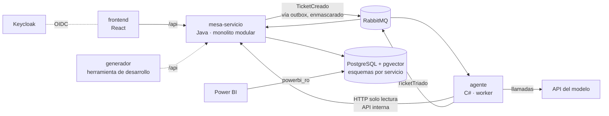

# Arquitectura

Decisión y alternativas en `docs/decisiones/ADR-003-cambio-dominio-tickets.md` (estado: Aceptado). ADR-001 queda como historia del dominio anterior.

## Vista general



## Servicios

| Servicio | Responsabilidad | Escribe en | Lee de | Arquitectura interna |
|---|---|---|---|---|
| `mesa-servicio` | Tickets, SLA, tablero Kanban, cambios, base de conocimiento, auditoría y vistas de reporte. Enmascara datos sensibles antes de que salgan hacia el agente | Esquemas `mesa_servicio`, `auditoria` y `reportes` | Eventos | Monolito modular |
| `agente` | Triaje con IA: categoría, sistema afectado, prioridad sugerida, posibles duplicados, artículos sugeridos y borrador de respuesta. Solo recomienda | Esquema `agente` (mensajes y tickets procesados, métricas, tokens del día) | API interna de `mesa-servicio`, eventos | Hexagonal ligero |
| `frontend` | Portal del solicitante, bandeja y tablero del técnico, aprobación de cambios, vistas del auditor | — | `/api` de `mesa-servicio` | Bulletproof React |
| `generador` | Herramienta de desarrollo: crea tickets sintéticos para pruebas y KPIs. No es parte del producto | — (usa la API de `mesa-servicio`) | — | Capas clásicas |

## Módulos de `mesa-servicio`

| Módulo | Qué hace |
|---|---|
| `tickets` | Crear, asignar, cambiar estado, comentar. Tipos: incidente, solicitud, problema, cambio. Estados: `nuevo → triado → asignado → en_progreso → en_espera → resuelto → cerrado`. Guarda la sugerencia del agente (`TicketTriado`) y lo que el técnico hizo con ella. Expone la API interna de solo lectura para el agente, siempre con texto enmascarado |
| `sla` | Políticas por prioridad (P1–P4) con tiempo de respuesta y de resolución, en UTC y con calendario laboral. Pausa en `en_espera`. Alerta al 75 % y escala al vencer, con eventos en memoria (`SlaPorVencer`, `SlaVencido`) |
| `tablero` | Kanban de incidentes y solicitudes con límite de trabajo en curso por columna |
| `cambios` | Flujo de aprobación con segregación de funciones (solicitante ≠ aprobador ≠ ejecutor), ventana de ejecución y plan de reversa obligatorio |
| `conocimiento` | Artículos de solución con embeddings en pgvector. Los tickets resueltos alimentan sugerencias de artículos nuevos |
| `auditoria` | Bitácora de solo inserción de toda acción: quién, qué, cuándo, antes y después |
| `reportes` | Vistas SQL de KPIs para Power BI y `reportes.parametros` (precios, umbrales, supuestos) |

Los módulos se comunican por su `api/` y por eventos de aplicación en memoria; RabbitMQ solo se usa con el `agente`.

## Base de datos

Una base `centinela` en PostgreSQL con pgvector. Los roles y esquemas los crea `deploy/postgres/init/01-esquemas-y-usuarios.sh` al levantar el contenedor por primera vez.

| Rol | Para qué | Permisos |
|---|---|---|
| `mesa_servicio` | Dueño de `mesa_servicio`, `auditoria` y `reportes`. Solo lo usa Flyway | DDL en sus esquemas |
| `mesa_servicio_app` | Con este corre `mesa-servicio` | Lectura y escritura en `mesa_servicio`; `SELECT` e `INSERT` en `auditoria`; `SELECT` en `reportes` |
| `agente` | Dueño y usuario del esquema `agente` | Solo su esquema |
| `powerbi_ro` | Power BI | `SELECT` sobre `reportes`, sesiones de solo lectura |

Por qué dos roles en `mesa-servicio`: el dueño de una tabla siempre puede modificarla. Separar al dueño (migraciones) del rol con el que corre la aplicación es lo que hace que la bitácora sea realmente de solo inserción.

La extensión `vector` vive en el esquema `mesa_servicio`.

## Interior del `agente` (hexagonal ligero)

```
services/agente/
├── src/Centinela.Agente/
│   ├── Dominio/          Ticket, Triaje, PrioridadSugerida, PresupuestoTriaje (sin dependencias externas)
│   ├── Aplicacion/       CicloAgente (el loop), VerificadorEnmascarado, RegistroMetricas
│   ├── Puertos/          IClienteLlm, IHerramienta, IPublicadorEventos
│   └── Infraestructura/
│       ├── Llm/          ClienteAnthropicHttp (HttpClient a mano)
│       ├── Herramientas/ BuscarTicketsSimilares, BuscarArticulosConocimiento, ConsultarEstadoServicio
│       └── Mensajeria/   Consumidor y publicador de RabbitMQ
└── tests/
    ├── Centinela.Agente.Tests/       unitarios del ciclo con un IClienteLlm falso
    └── Centinela.Agente.Adversarial/ suite de ataques
```

Justificación de las interfaces: `IClienteLlm` es una frontera real (API externa) y permite probar el ciclo sin gastar tokens; `IHerramienta` tiene varias implementaciones reales; `IPublicadorEventos` separa el dominio de RabbitMQ.

## Estructura del repositorio

```
centinela/
├── AGENTS.md · CLAUDE.md · README.md · .env.example · compose.yml
├── services/
│   ├── mesa-servicio/
│   └── agente/
├── frontend/
├── tools/generador/          tickets sintéticos (solo desarrollo)
├── tests/adversarial/        casos de ataque compartidos (datos de entrada)
├── deploy/                   postgres/ (init de desarrollo), nginx/ y k8s/ (fases 8 y 9)
└── docs/
    ├── CONTEXTO.md · ARQUITECTURA.md · ROADMAP.md · SEGURIDAD.md
    ├── KPIS.md · EVENTOS.md · FLUJOS.md · DESPLIEGUE.md (fase 8)
    └── decisiones/
```
